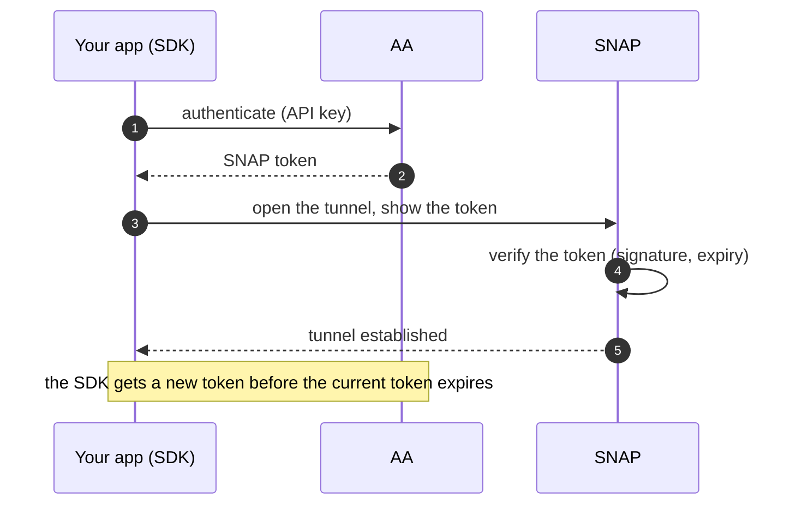

On the SNAP underlay (see [Transport underlays](./transport-underlays.md)), your app sends its
traffic through a SNAP. The SNAP forwards the traffic only if your app shows a valid **SNAP token**.
To get a SNAP token, your app must authenticate with the Anapaya Authentication and Authorization
service (**Anapaya AA**). The Anapaya AA returns SNAP tokens for your **subscription**. This page
explains these terms, and it shows how the SDK gets and renews the SNAP token.

## Subscriptions

A **SCION subscription** gives access to the SCION network through SNAPs. Each subscription has an
**SSID** (SCION subscription ID). The traffic that your app sends through a SNAP is accounted under
your subscription.

## Resellers and AAs

A **reseller** sells SCION subscriptions to customers. For each subscription, the reseller selects
the AAs that can request SNAP tokens for that subscription.

An **AA** (Authentication and Authorization service) is the service that your app sends its API key
to. The AA authenticates your app with the API key and returns a SNAP token for the corresponding
subscription.

Anapaya is a SCION subscriptions reseller and operates the **Anapaya AA** at
`https://auth.scion.anapaya.net`.

## SNAP tokens

A **SNAP token** is a short-lived bearer credential: a signed JSON Web Token (JWT) with an expiry
time. The SNAP verifies the token before it forwards your traffic. Your app does not have to read
the token. It gives the token to the SDK.



## Token sources

The SDK gets the SNAP token from a **token source**
([`TokenSource`](https://docs.rs/reqwest-connect-rpc/latest/reqwest_connect_rpc/token_source/trait.TokenSource.html)).
You give the token or the token source to the stack when you build it. There are two methods:

- [`with_auth_token`](https://docs.rs/scion-stack/latest/scion_stack/stack/builder/struct.ScionStackBuilder.html#method.with_auth_token)
  takes a static token string.
- [`with_auth_token_source`](https://docs.rs/scion-stack/latest/scion_stack/stack/builder/struct.ScionStackBuilder.html#method.with_auth_token_source)
  takes a token source that renews the token.

### Local development

PocketSCION accepts a fixed development token
([`pocketscion::util::dev_auth_token`](https://docs.rs/pocketscion/latest/pocketscion/util/fn.dev_auth_token.html)).
The SDK examples give it to the stack as a static token:

```rust reference="@sdk/crates/scion-stack/examples/common/mod.rs#build-stack" title="examples/common/mod.rs"
```

### The Anapaya AA token source

The `anapaya-aa-client` crate supplies
[`AnapayaAaTokenSource`](https://docs.rs/anapaya-aa-client/latest/anapaya_aa_client/token_source/struct.AnapayaAaTokenSource.html).
This token source exchanges your API key for a SNAP token at the Anapaya AA. It also renews the
SNAP token periodically: before the current token expires, it sends the API key to the Anapaya AA
again and gets a new token. Your app does not have to do anything for the renewal.

The HTTP/3 client takes the token source through
[`Config::with_auth_token_source`](https://docs.rs/scion-http3/latest/scion_http3/struct.Config.html#method.with_auth_token_source):

```rust reference="@sdk/crates/libs/scion-http3/examples/http3_get_post.rs#api-key" title="examples/http3_get_post.rs"
```

## Get an API key

To try the SDK on the SCION network, request an Anapaya API key by filling out [this
form](https://docs.google.com/forms/d/e/1FAIpQLSecEBRjokPNhFqNN7xJueUv26kuoA0H9QHGwAVWM8DuG-qJHA/viewform).

Do not put the API key in a public location, for example a public repository. Anyone with the key
can get SNAP tokens for your subscription.

## Where to go next

- **[Transport underlays](./transport-underlays.md):** the SNAP underlay that uses the SNAP token.
- **[The ScionStack model](./scionstack-model.md):** the stack that you give the token source to.
- **[The endhost API](./endhost-api.md):** how the stack finds the endhost API, also through the
  Anapaya AA.
