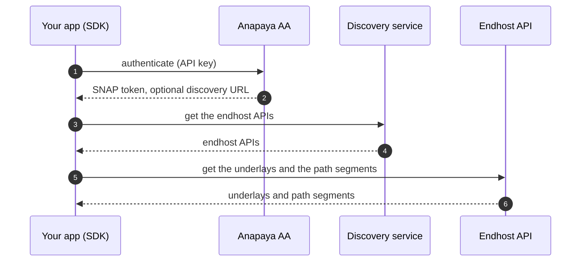

Before the SCION stack can send traffic, it must know how to reach the SCION network. The **endhost
API** supplies this information. This page explains what the endhost API is and how the stack finds
an endhost API.

## What the endhost API is

The endhost API is a service of the SCION network. It supplies two types of information to the
stack:

- **Underlays:** how the stack sends SCION packets to the network. See [Transport
  underlays](./transport-underlays.md).
- **Path segments:** the parts from which the stack builds the paths to a destination. See [Paths
  and path policies](./paths-and-policies.md).

## How the stack finds the endhost API

You select the endhost API source when you build the stack:

| Builder method | Endhost API | Use it for |
| --- | --- | --- |
| None (the default) | The endhost APIs from the global discovery service. | The public SCION network. |
| [`with_endhost_api`](https://docs.rs/scion-stack/latest/scion_stack/stack/builder/struct.ScionStackBuilder.html#method.with_endhost_api) | One fixed endhost API. | Local development with PocketSCION, or a specific endhost API you want to use. |
| [`with_endhost_api_discovery_source`](https://docs.rs/scion-stack/latest/scion_stack/stack/builder/struct.ScionStackBuilder.html#method.with_endhost_api_discovery_source) | The endhost APIs from a source that you supply. | Discovery through the Anapaya AA, or a specific deployment. |

### Endhost API discovery

An **endhost API discovery service** tells the stack which endhost APIs to use. The service puts the
endhost APIs that are near your app first. If an endhost API does not answer, the stack tries a
different endhost API.

Anapaya operates the **global discovery service** at `https://discovery.scion.anapaya.net`. The
stack uses this service if you do not set an endhost API source.

### Discovery through the Anapaya AA

The Anapaya AA can send a discovery URL together with the SNAP token. This URL identifies the
discovery service for your subscription. To use this discovery service, give the stack the endhost
API source of your token source
([`AnapayaAaTokenSource::endhost_api_source`](https://docs.rs/anapaya-aa-client/latest/anapaya_aa_client/token_source/struct.AnapayaAaTokenSource.html#method.endhost_api_source)).
If the Anapaya AA sends no discovery URL, this source uses the global discovery service.

## Where to go next

- **[The ScionStack model](./scionstack-model.md):** the stack that you give the endhost API source
  to.
- **[Transport underlays](./transport-underlays.md):** the underlays that the endhost API supplies.
- **[Access and authentication](./access-and-authentication.md):** the Anapaya AA and the SNAP token
  that the stack sends to the endhost API.
